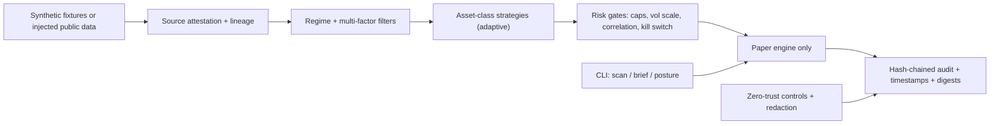

# Architecture v0.40

## Design principles
- Paper-only by construction. Mode guards refuse live execution.
- Injectable I/O so tests never touch the network.
- Data lineage: every payload carries a digest and source label (SYNTHETIC / PUBLIC_READ).
- Zero-trust: least privilege, assume credentials may leak, redact aggressively.
- Inspired by zeekiankok92 harness: agent rules, CI gates, disclosure trail, human sign-off.

See security-architecture.md for controls.
