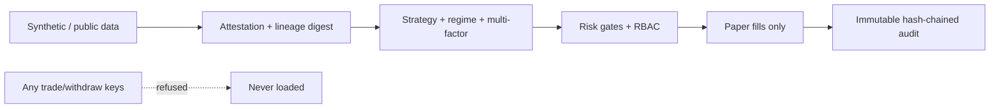

# Cyber and data security architecture (v0.40)

Zero-trust research design. Not a certified product or legal advice. Builds on prior versions and harness patterns from zeekiankok92.

## Trust boundaries

## Controls
- **Paper-only mode guard**: any non-PAPER raises PermissionError.
- **Secret refusal**: names containing trade, withdraw, transfer, order, private_key, mnemonic, seed are rejected.
- **Advanced redaction**: patterns for API keys, AWS, GitHub PATs, BIP39-like phrases, wallet addresses, emails, phones, NRIC-style IDs.
- **Data lineage**: SHA-256 of source label + payload; any change alters digest.
- **Audit log**: sequence, timestamp (UTC), action, detail, prior hash — chain verification.
- **RBAC**: Researcher / Auditor / Operator. No role can enable live trading or place orders.
- **Kill switch & drawdown halt**: size forced to zero; human must clear.
- **Feed integrity**: stale, jump, non-positive price flags.
- **Isolation**: research plane never holds execution credentials.
- **CI recommendations**: gitleaks, ruff security rules, personal-data tripwire (PDPA-style), coverage, licence allow-list.

## Data classification
| Class | Examples | Handling |
|---|---|---|
| Public market | OHLCV, funding | Synthetic preferred |
| Integrity | Source labels, digests | Must match SYNTHETIC / PUBLIC_READ |
| Secret | Trade keys, mnemonics | Refused + redacted |
| Sensitive | Wallet addresses | Redacted, banned from fixtures |
| Personal | Emails, phones, IDs | Tripwire |

## Threats addressed
- Committed secrets → gitleaks + redaction + refusal
- Fixture swap / injection → attestation + label check
- Audit tamper → hash chain
- Privilege creep → no trader role
- Data leakage via agent context → AGENTS.md rules + tripwire

## Operating rules
Market-data keys (if any) must be read-only and never logged. Logs always redacted. Promote to live only in a separate human-approved system.
